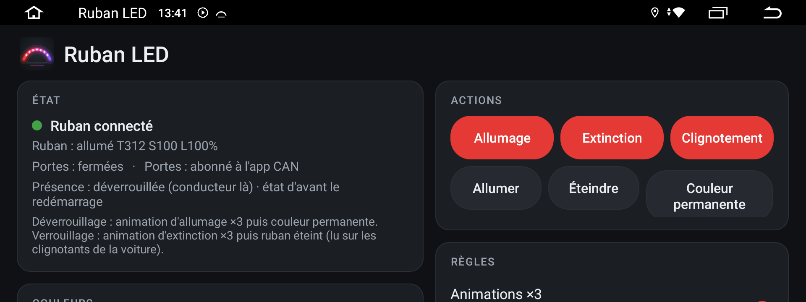
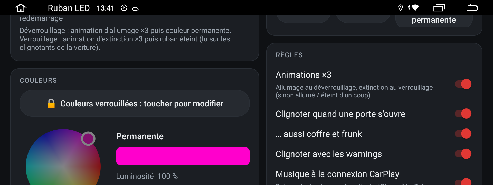
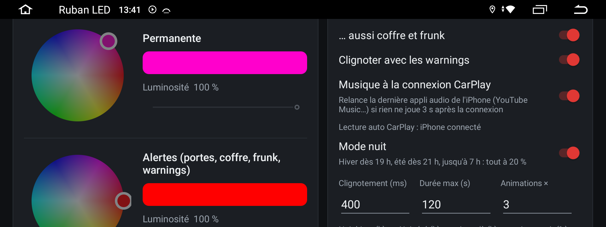
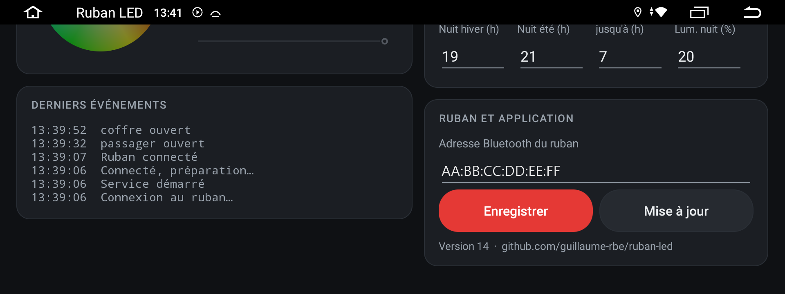

# Ruban LED

Petite app Android pour l'écran d'instruments Android 10,25" des Tesla Model 3/Y (ODM ZIQI « A007 »,
vendu sous les noms Carview, Tesery…) qui pilote en Bluetooth LE un ruban LED d'ambiance Zengge
(app « ZENGGE », `com.zengge.blev2`) selon la voiture : verrouillage, portes, warnings, recharge.

Elle tourne à côté de [Binnacle](https://github.com/lotech/binnacle) (tableau de bord de remplacement
pour cet écran) mais n'en dépend pas : elle lit elle-même les portes, les feux et la batterie,
**en lecture seule**, auprès de l'app CAN d'origine (`com.xbs.canapp`, codes 15, 9 et 11, seules
transactions `regPropIdList`/`unregPropIdList`, comme le `CanFeed` de Binnacle). Rien n'est envoyé à
la voiture ni au MCU.

## Captures (écran 1920×720 de l'A007)

État du ruban et de la voiture, présence (verrouillage) et actions (depuis la 0.17, les boutons de test sont masqués sous « Boutons de test » : « Animation d'allumage », « Animation d'extinction », « Clignotement d'alerte », « Animations à l'arrêt », qui joue les 5 animations d'arrêt l'une après l'autre) :



Couleurs verrouillées par défaut (un bouton les débloque, pour qu'un doigt qui fait défiler la page
ne change pas une couleur) ; règles :



Les deux roues grisées tant qu'elles sont verrouillées (couleur permanente, couleur d'alerte rouge) ;
option « Musique à la connexion CarPlay » et son état :



Derniers événements, adresse du ruban et mise à jour :



Documentation :
- [docs/DONNEES-CAN.md](docs/DONNEES-CAN.md) : les champs lus, le relevé du verrouillage, ce qui
  n'est pas dans le flux (Auto Hold, limiteur) ;
- [PROTOCOLE.md](PROTOCOLE.md) : le protocole Bluetooth du ruban Zengge.

## Ce qu'elle fait

- **Verrouillage = présence** : l'app lit la confirmation lumineuse de la Tesla sur les clignotants
  (code 9). **Un flash** des deux clignotants = voiture verrouillée (le propriétaire part) :
  animation d'extinction **3 fois**, puis ruban éteint. **Deux flashs**, ou les feux d'accueil
  (`postlight`) qui s'allument = déverrouillée (il arrive) : animation d'allumage **3 fois** dans la
  couleur permanente, puis couleur permanente. Verrouillée, rien ne s'allume (ni warnings, ni jauge
  de recharge), pour ne pas gaspiller d'énergie. Une porte qui s'ouvre voiture « verrouillée » vaut
  déverrouillage (il a été manqué). Déverrouillée, une porte qui s'ouvre fait clignoter le ruban.
  Relevé le 17 nov. : verrouillage auto en s'éloignant ≈ 10 s après la fermeture de la porte ;
  au retour, feux d'accueil puis deux flashs au moment où la porte s'ouvre. Il faut la
  confirmation lumineuse du verrouillage activée dans les réglages Tesla.
  Le dernier état (verrouillée / déverrouillée) est gardé quand l'app redémarre (mise à jour).
- **Animations** : uniquement au verrouillage et au déverrouillage détectés (jamais sur une porte).
  L'allumage remplit le ruban progressivement (~5 s, **3 fois**) dans la couleur permanente
  (ambiante) : les portes de l'arrière vers l'avant, le tableau de bord depuis les deux bouts.
  L'extinction fait l'inverse. Interrupteur « Animations ×3 » : sans lui, allumé / éteint d'un coup.
- **Clignotement** : chaque porte, coffre ou frunk qui s'ouvre (même si une autre est déjà
  ouverte, et même conducteur à bord) fait clignoter le ruban (couleur d'alerte, rouge par défaut,
  100 % ↔ 1 %, 400 ms, 2 min max).
- **Coffre d'abord en arrivant** : si en arrivant (déverrouillage, ou voiture encore vue
  verrouillée) le coffre ou le frunk s'ouvre avant toute portière, il clignote en rouge comme
  d'habitude (l'animation d'allumage s'arrête si elle tournait) et l'animation d'allumage est
  gardée pour la première portière ouverte (dans les 15 min), à la place du clignotement.
- **Marche arrière** (option, activée par défaut) : tant que la marche arrière est passée (code 11
  `gear` = 1), un blanc qui respire (de 15 % à 100 % du blanc et retour, toutes les 2 s), ce blanc
  étant un peu plus fort que la couleur permanente (+30 points, ×1,5 au moins ; 50 % la nuit), puis
  la couleur habituelle. Une porte qui s'ouvre clignote quand même, et le blanc
  revient après si la marche arrière est toujours passée.
- **Autosteer** (option, activée par défaut) : à son activation (code 9 `autodrivermode`), 1 s dans
  le bleu de l'Autopilot de Binnacle (teinte 212°, saturation 88 %) à la luminosité du moment, puis
  la couleur permanente. Le régulateur seul (TACC) et le limiteur n'ont pas de champ dans le flux
  (essai du 23 nov. : rien ne bouge ; `speedlimitsw` du code 10 est l'affichage du panneau de
  vitesse, vrai dès qu'on roule, faux en P).
- **Après chaque animation** : toujours la couleur permanente (la jauge pendant la recharge), ou
  ruban éteint si la voiture est verrouillée.
- **Warnings** : à partir de **3 flashs** de suite des deux clignotants (1 ou 2, c'est le
  verrouillage), et tant qu'ils continuent, le ruban clignote dans la couleur d'alerte.
- **Recharge** : pendant la charge (code 9 `chargelight`), et seulement voiture déverrouillée, le ruban
  devient une jauge verte du pourcentage de batterie (code 11, décodé comme Binnacle) : une barre
  fixe au milieu du tableau de bord, aussi large que le % (50 % = la moitié du tableau de bord),
  et de chaque bout un remplissage vert qui court vers elle, en boucle (~5 s). Sur les portes,
  c'est un remplissage de l'arrière vers l'avant qui finit dans la barre (à l'avant de la porte) ;
  à 100 % tout est vert fixe.
- **Animation à l'arrêt** (option, activée par défaut) : quand la voiture attend en Auto Hold
  (code 9 `autohandlight`, l'icône de frein « HOLD » au feu rouge, en D) depuis plus d'**1 s**, une
  fois sur 4 au hasard (réglable : « Arrêt : 1 sur »), une animation tirée au hasard (jamais deux
  fois la même de suite) dans la couleur permanente, dessinée pour le tableau de bord, jusqu'au
  départ : **respiration lente** (5 s par souffle), **croisement** (une lumière part de chaque bout,
  elles se croisent au milieu et continuent jusqu'à l'autre bout, ~4 s), **du centre vers les
  bouts** (~2,4 s), **scintillement** (des points s'allument au hasard sur un fond doux),
  **vague de couleur** (la teinte ondule de ±50° autour de la couleur permanente et défile, ~4 s).
  Elle arrive en fondu (~1 s) et repart en fondu court (~0,5 s) dès que l'Auto Hold se relâche.
  Les portes montrent les segments 1 à 10 (même signal) : elles suivent les deux tiers droits du
  tableau de bord. Rien si la voiture charge, qu'une autre animation tourne ou qu'une porte s'ouvre
  (le clignotement passe devant).
- **Veille** : quand l'écran s'éteint (voiture endormie), le ruban s'éteint, sans animation
  (en général il l'est déjà depuis le verrouillage). Utile car il est alimenté par
  l'USB de la boîte à gants, qui reste alimenté tant que la voiture est éveillée (Sentinelle
  comprise).
- **Musique à la connexion CarPlay** (option, activée par défaut) : quand l'iPhone se connecte à
  l'app CarPlay de l'écran (`com.shilapi.xcertplay`), si rien ne joue 3 s plus tard, l'app envoie
  « lecture » à la session média de CarPlay (jusqu'à 3 essais) : l'iPhone relance sa dernière appli
  audio (YouTube Music…). La connexion se lit sur les commandes de cette session (128 sans iPhone,
  692 / 690 avec). Il faut donner une fois à Ruban LED l'**accès aux notifications** d'Android
  (bouton dans la carte « Règles ») : c'est ce qui permet de voir la session média d'une autre app ;
  aucune notification n'est lue. Validé le 17 nov. ; remplace une automatisation iOS peu fiable.
- **Mode nuit**, activé par défaut : de 19 h (heure d'hiver) ou 21 h (heure d'été) à 7 h, tout le
  ruban (couleur permanente, animations, jauge) à 20 %. Heures et luminosité réglables.
- **Deux couleurs** réglables dans l'app, chacune avec sa roue et sa jauge de luminosité :
  couleur permanente, et couleur d'alerte (rouge 100 % par défaut, réservée aux portes, coffre, frunk et warnings).
- Écran sombre en cartes : état, présence, couleurs, derniers événements (heure de chaque porte,
  connexion du ruban… pour voir d'où vient un retard), actions, règles, ruban et mise à jour.

## Journaux (0.20)

Pour déboguer sans recompiler l'app : un journal large, gardé sur l'écran **7 jours et 150 Mo au
plus** (une semaine avec de longs trajets en journal détaillé) (fichier par jour dans le stockage privé de l'app, le plus ancien supprimé en premier), une
ligne par fait : `HH:mm:ss.SSS ÉTIQUETTE message`.

| Étiquette | Contenu |
|---|---|
| `EVT` | les lignes de « Derniers événements » |
| `REGLE` | chaque décision et sa raison (animation lancée, refusée parce que…, ce qui suit une animation) |
| `CAN` | chaque message reçu de l'app CAN, tous ses champs (un message identique n'est réécrit qu'une fois par minute) |
| `BLE` | chaque commande envoyée au ruban (en hexadécimal), son accusé et son délai, les réponses du ruban, la file en retard |
| `LIEN` | connexion Bluetooth, MTU |
| `ECRAN` / `APP` / `ENVOI` | commandes de l'écran, démarrage, réglages, plantages, envois |

**Journal détaillé** (activé par défaut) : `CAN` de tous les codes et `BLE` de chaque image ; sinon
seulement les données des règles et les commandes. **Codes CAN en plus** : `2,3,4` ou `0-127`,
enregistrés tels quels (abonnement en lecture seule, comme les autres).

**Envoi** : bouton « Envoyer les journaux (24 h) » ou « Tout (7 jours) ». Chaque étape s'affiche
(certificat, lecture, compression, connexion, envoi avec barre d'avancement, réponse), ✓ ou ✗ avec
la raison. Le fichier part en `PUT` HTTPS, en gzip (20 Mo au plus, soit 150 à 200 Mo de texte, préparé dans un fichier
temporaire et envoyé en flux ; au-delà, les jours les plus anciens sont retirés), avec en tête l'état de l'app, ses réglages (sans l'adresse du ruban) et son
logcat. L'adresse du serveur et le certificat client sont dans le stockage privé de l'app
(`files/journaux.conf` : `url=…` et `password=…`, `files/client.p12`), posés par ADB : rien de
tout cela n'est dans ce dépôt. Côté serveur, il suffit d'accepter un `PUT` sur
`/journaux/ruban-AAAAMMJJ-HHMMSS.log.gz` avec ce certificat client.

## Réglages de l'écran

Option « Écran : position activée (plus d'alerte Google) » (activée par défaut) : à chaque
démarrage, l'app lance par l'ADB réseau de l'écran (127.0.0.1:5555, sans authentification sur cet
écran, comme Binnacle) une liste **fixe** de commandes, jamais une commande venue de l'extérieur :

| Quoi | Commande | Annuler |
|---|---|---|
| Position en mode appareil seul (GPS) | `settings put secure location_mode 1` puis `location_providers_allowed +gps` | le mode d'avant, gardé par l'app (`settings put secure location_mode <0-3>`) |

Pourquoi : la fenêtre de Google « L'accès à la position de l'appareil étant désactivé… »
(Localiser mon appareil, *Fermer / Activer la localisation*) s'affiche au démarrage quand aucun
fournisseur de position n'est actif. L'écran n'a pas de position par le réseau : le mode « réseau
seul » des versions 0.19 à 0.23 revenait à tout couper (la fenêtre restait). Le mode appareil seul
garde le GPS comme seul fournisseur, sans scans Wi-Fi ni réseau Google (la précision de la
localisation Google reste coupée). L'état avant / après et l'écran au premier plan ~45 s après le démarrage sont notés dans
« Derniers événements » (pour nommer la fenêtre si elle revenait).

## Priorité et réactivité

- Les règles tournent sur leur propre fil de priorité haute (plus sur le fil de l'écran), le fil
  Bluetooth aussi ; la connexion BLE est en intervalle court (demandé dès la connexion) et se refait
  toutes les 2,5 s.
- **Pas de retard qui s'accumule** (0.18) : une image d'animation qui attend encore son envoi est
  remplacée par la suivante au lieu d'être envoyée après (seule la plus récente compte), donc le
  ruban n'a jamais plus d'une image de retard, même si le Bluetooth ralentit.
- Le ruban accuse réception de chaque commande : la pause entre deux envois est passée de 40 à
  8 ms. Le ruban est prêt dès que ses notifications sont activées (plus d'attente fixe de 300 ms).
- « Allumer » n'est plus envoyé quand le ruban est déjà allumé : une porte qui s'ouvre clignote un
  aller-retour Bluetooth plus tôt. Après une perte de connexion, l'état du ruban est redemandé et le
  premier envoi le rallume quoi qu'il arrive.
- **Au réveil de la voiture** (0.18), l'app se connecte au ruban tout de suite, puis réessaie toutes
  les 0,5 s pendant 30 s (2,5 s sinon).
- **Commande couleur courte** (0.18) : une couleur unie part en 13 octets (`3B A1 …`, même forme que
  allumer/éteindre) au lieu de 87. Pas capturée depuis l'app ZENGGE : vérifiée une fois sur le ruban
  (envoyée à 1 point de luminosité près, puis l'état du ruban est relu) et utilisée seulement si
  elle marche ; le résultat est noté dans « Derniers événements ».
- Service au premier plan (notification « Ruban LED actif »), relancé au démarrage, après une mise à
  jour et toutes les 15 min s'il a été arrêté ; le processeur reste éveillé pendant les animations.
- Au premier lancement, Android demande de laisser l'app hors de l'optimisation de la batterie :
  accepter. Sur l'A007, ajouter aussi `app.rubanled` dans `/data/system/appPowerSaveConfig.xml`
  (voir plus bas).

## Câblage constaté

Le contrôleur a trois sorties qui reçoivent **le même signal** (20 segments d'environ 7,5 cm) :
les deux portes (75 cm) affichent les segments 1 à 10 depuis l'arrière, le tableau de bord (110 cm)
les segments 1 à 15 depuis la droite. Les deux portes ne peuvent donc pas être pilotées séparément.

## Protocole

Voir [PROTOCOLE.md](PROTOCOLE.md) (capturé avec le journal HCI Android pendant l'utilisation de
l'app ZENGGE). Points à retenir :

- service `FFFF`, écriture `FF01` **avec réponse** (propriétés 0x0C) : en écriture sans réponse, le
  ruban perd des commandes quand elles s'enchaînent ;
- les notifications d'état (`FF02`) décrivent la commande **précédente** : l'app retient ce qu'elle
  envoie et ignore les réponses qui arrivent moins de 1,5 s après un envoi ;
- « allumer » envoyé juste après une couleur remet du blanc : allumer d'abord, couleur ensuite.

## Compiler et installer

Outils du SDK Android seulement (pas de Gradle) : build-tools 36, plateforme android-35, le JDK
d'Android Studio, Python.

```bash
bash build.sh
adb install -r build/ruban-led.apk
```

Au premier lancement, saisir l'adresse Bluetooth du ruban dans l'app (elle n'est pas dans le code)
puis « Enregistrer ». Sur l'A007, ajouter `app.rubanled` dans `/data/system/appPowerSaveConfig.xml`
(même ligne que `com.shilapi.xcertplay`, `autolaunch="2" secondarylaunch="2"`) pour qu'elle démarre
avec l'écran.

Signée avec la clé de debug du PC (`~/.android/debug.keystore`). Garder toujours la même clé :
sinon Android refuse la mise à jour.

## Mises à jour depuis l'app

Le bouton « Mise à jour » cherche dans les releases de ce dépôt (`guillaume-rbe/ruban-led`) la plus récente
taguée `ruban-led-v<versionCode>`, plus récente que la version installée. Il télécharge
`ruban-led.apk`, vérifie son SHA-256 (`ruban-led.apk.sha256`), puis l'installe avec
l'installateur d'Android, verrouillé sur ce paquet : Android affiche sa propre confirmation et
n'accepte qu'une APK signée avec la même clé. La première fois, autoriser « Installer des
applis inconnues » pour Ruban LED (l'app ouvre l'écran d'Android).

Si Android refuse la connexion de l'app (« socket failed: EPERM », vu sur l'A007 quand la
permission Internet est arrivée par une mise à jour : Android la donne mais le processus ne l'a
pas), l'app passe par le gestionnaire de téléchargements d'Android, qui télécharge à sa place.
Redémarrer l'écran une fois corrige cet accès refusé.

L'avertissement de Google Play Protect (« application non sûre ») à chaque mise à jour vient de ce
que l'app n'est pas sur le Play Store : « Installer quand même », ou couper l'analyse de Play Protect
dans le Play Store.

Publier une version : augmenter `android:versionCode` dans `AndroidManifest.xml`, écrire ses
nouveautés dans [CHANGELOG.md](CHANGELOG.md) (section `## <versionName>`), pousser `main`, puis
`bash release.sh` (crée la release avec `gh`, avec ces nouveautés pour texte, et la marque « latest »).

## Licence et crédits

GPL-3.0 (voir [LICENSE](LICENSE)), comme Binnacle, dont viennent la façon de lire l'app CAN en
lecture seule et la table de décodage de la batterie (`Battery.java`). Merci à lotech et aux
contributeurs de Binnacle.
